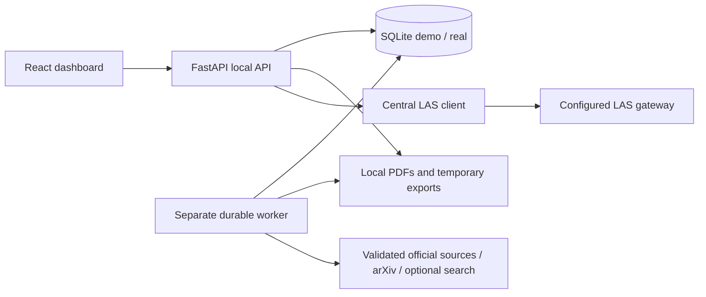

# Architecture and data flow

`endless-tuna/` contains the active app. Root Flask files belong to the preserved earlier prototype; do not load their environment or change their model client. Display name is **endless tuna**, project slug **endless-tuna**, Python import name `endless_tuna`.

The frontend uses React, TypeScript and Vite, hash routes with URL search/filter state, a pale-blue rounded search panel, desktop sidebar/two-column cards and narrow collapsible filters/one-column cards. Native startup binds loopback. The production frontend can be served by FastAPI; Vite development proxies `/api`. No secrets belong in frontend state or VITE variables. System sans-serif fonts make layout independent of external font delivery.

SQLite uses WAL, foreign keys, ordered transactional SQL migrations and FTS5. `demo.sqlite3` and `real.sqlite3` have independent PDF/export folders. `X-Collection` selects the API database; export file routes also validate collection. Demo seeding is fictional and visibly labeled; real initialization creates no invented papers.

Stable IDs relate series → editions → tracks, canonical papers ↔ edition memberships, ordered authorship and paper-specific many-to-many organizations. Official source URLs/timestamps establish membership. Author names alone never establish shared identity. Assertion rows retain source excerpts, pages, extraction methods, time context and verification status; corrections append history. Reversible identity edges preserve original authorship and assertions.

Collection requests persist jobs and input snapshots before work. A worker atomically claims one job with a lease token, heartbeats, checkpoints each paper, and validates ownership before writes. Inventory → resolution → download → page text → deterministic enrichment is independent of LAS. Failures are isolated per paper. Graceful stopping finishes a submitted bounded batch then requeues remaining work; forced termination relies on 120-second lease expiry. Counts distinguish official inventory, collected membership, PDFs, ambiguous results and indexed text. A sample cap never establishes full inventory completeness.

Collection HTTP uses public URL/DNS/redirect validation, address pinning, rate limiting, timeouts, bounded retries/concurrency/size, and PDF parsing/hash validation. Official PDFs are preferred; conservative arXiv title+author evidence and reviewable provider/manual candidates preserve version provenance. LAS traffic is intentionally separate from those public-URL rules, so a configured lab gateway can be used.

All model inference passes through `las.py`, using configured ordinary OpenAI-compatible `/models` and `/chat/completions` only. Explicit server-side model IDs, bearer credentials, bounded inputs, strict output schemas and evidence validation apply. Untrusted paper/web text cannot authorize tools or change behavior. No provider fallback, embedding dependency or model-based search exists. Settings discovery and test completions are explicit actions.

FTS compiles literal safe units and searches conference metadata, titles, abstracts and versioned page text. Stable distinct paper IDs produce grouped conference counts, pagination and evidence snippets. It works offline on stored records. Excel/ZIP selection shares search semantics; artifacts are disk-backed, ID-addressed, TTL-limited and stored outside source control. Export text is protected against spreadsheet formulas; ZIPs enforce safe names, per-part size limits, provenance manifests and missing-file reports.

This is a local single-user tool, not an authenticated multi-user service. Collection endpoints need external source access; enrichment needs LAS only when explicitly requested. See [configuration](configuration.md), [collection](collection.md), [enrichment](enrichment.md), [search/exports](search-and-exports.md) and [limitations](known-limitations.md).
